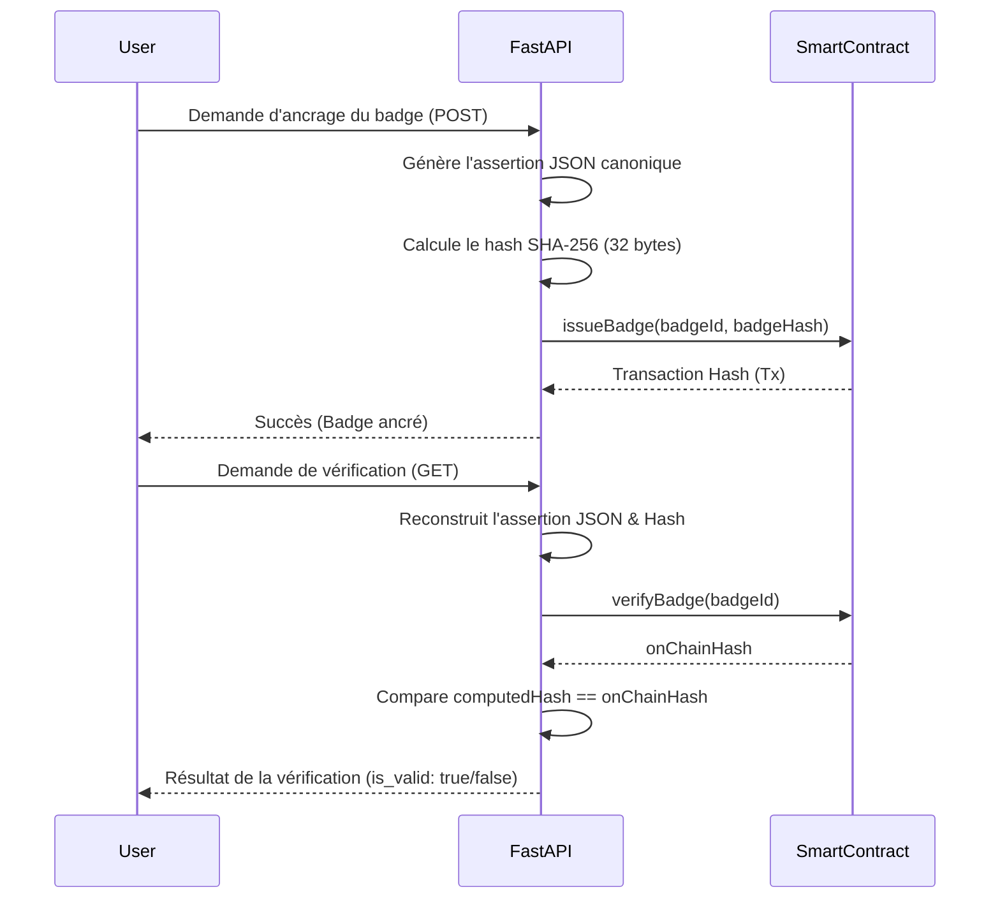

# 🎓 Skill Badge Platform

Plateforme intelligente d'évaluation de compétences par IA et de délivrance de badges numériques sécurisés par blockchain.

**Stage d'été 2026** — Encadrantes : Mme Souha Bennani & Mme Feriel Abbes

---

## 🛠️ Spécifications Techniques & Technologies

| Couche | Technologie | Rôle |
|---|---|---|
| **Backend** | Python / FastAPI | API REST performante et typée |
| **Base de données** | SQLite (SQLAlchemy) | Stockage local léger des utilisateurs et badges |
| **Sécurité** | JWT / bcrypt | Authentification et hachage des mots de passe |
| **Intelligence Artificielle** | Google Gemini API | Évaluation automatisée via `google-generativeai` |
| **Blockchain** | Ethereum / Web3.py | Ancrage cryptographique (Smart Contract Solidity) |

---

## 🧩 Architecture & Logique de Vérification

Le module blockchain garantit l'immuabilité et l'authenticité des badges. L'architecture repose sur la norme **OpenBadge v2.0**.



---

## 📁 Structure du projet

```text
STAGE/
├── main.py                 # Point d'entrée, routes (API, Blockchain)
├── blockchain_service.py   # Logique d'interaction Web3 et Hachage
├── contract_abi.json       # Interface ABI du Smart Contract Solidity
├── models.py               # Modèles SQLAlchemy
├── schemas.py              # Schémas Pydantic (validation)
├── auth.py                 # Logique JWT, bcrypt
├── database.py             # Configuration SQLite
├── grader.py               # Évaluation IA (Gemini)
├── rubric.md               # Grille de compétences
├── requirements.txt        # Dépendances Python
├── .gitignore              # Règles Git
└── .env                    # Secrets (NON versionné)
```

---

## ⚙️ Configuration de l'Environnement

Ce fichier n'est **pas** inclus dans le dépôt (il contient des secrets). Crée un fichier `.env` manuellement à la racine du projet avec les variables suivantes :

```env
# Authentification & Base de données
JWT_SECRET_KEY=<demande la valeur à Heeba>
JWT_ALGORITHM=HS256
ACCESS_TOKEN_EXPIRE_HOURS=24
DATABASE_URL=sqlite:///./users.db

# IA
GEMINI_API_KEY=<clé_api_google_ai>

# Blockchain Configuration
WEB3_PROVIDER_URL=http://127.0.0.1:8545
CONTRACT_ADDRESS=0xa441e3bFBd6B0Ce296c7ee7D6f6DE53Ee618E3Cb
ISSUER_ADDRESS=0x88e218f5279d75982a5Ac2FccB62612E20a6A3b7
PRIVATE_KEY=0x9f2b4375b583da3dc5458d8138bc3b12b90217f37024053c748fe68c3a75757f
```

> [!WARNING]
> Ne jamais commiter ce fichier ni le partager publiquement. Assure-toi que les clés Web3 sont complètes sans troncature.

---

## 🚀 Guide d'Installation & Lancement

### 1. Cloner le dépôt

```powershell
git clone https://github.com/heeba-sf/skill-badge-platform.git
cd skill-badge-platform
```

### 2. Créer l'environnement virtuel

```powershell
python -m venv .venv
# Activation sous Windows (PowerShell) :
.\.venv\Scripts\Activate.ps1
# Activation sous Mac/Linux :
source .venv/bin/activate
```

Tu dois voir `(.venv)` apparaître au début de ta ligne de commande.

### 3. Installer les dépendances

```powershell
python -m pip install -r requirements.txt
```

### 4. Lancer le serveur

```powershell
uvicorn main:app --reload
```

Tu dois voir : `INFO: Uvicorn running on http://127.0.0.1:8000`

---

## 🧪 Procédure de Test (Swagger UI)

Ouvre `http://127.0.0.1:8000/docs` dans ton navigateur. C'est l'interface de test intégrée (Swagger).

**Workflow recommandé pour tester le module Blockchain :**

1. `POST /register` — Crée un compte utilisateur test.
2. `POST /login` — Récupère ton `access_token`.
3. Clique sur **Authorize** (cadenas en haut à droite) et colle le token.
4. `POST /submit` — Soumets un texte pour générer un badge (IA). Récupère le `badge_id` dans la réponse.
5. `POST /badges/{badge_id}/anchor` — Ancre le badge sur la blockchain (Génère le Tx Hash).
6. `GET /badges/{badge_id}/verify-on-chain` — Vérifie l'intégrité du badge. Le résultat doit retourner `"is_valid": true`.

> [!NOTE]
> Les logs du backend afficheront un comparatif détaillé du hash généré localement vs celui lu sur le Smart Contract pour le débogage.

---

## 🔄 Workflow Git

On ne travaille **jamais directement sur `main`**. Chacun travaille sur sa propre branche.

### Avant de commencer une tâche

```powershell
git checkout main
git pull origin main
```

### Créer une branche

```powershell
git checkout -b feature/nom-de-ta-tache
```

Exemples : `feature/badge-module`, `feature/blockchain-setup`

### Pendant que tu travailles

Commit régulièrement, avec des messages clairs :

```powershell
git add .
git commit -m "Ajout de l'intégration blockchain"
```

### Une fois ta tâche terminée et testée

```powershell
git push -u origin feature/nom-de-ta-tache
```

Puis va sur GitHub → tu verras une bannière "Compare & pull request" → clique dessus → décris brièvement ce que tu as fait → ouvre la Pull Request.

**On ne merge jamais sa propre Pull Request sans que l'autre l'ait relue**, même rapidement — ça permet à chacun de comprendre l'ensemble du projet, pas seulement sa propre partie.

---

## 👥 Répartition actuelle du travail

| Module | Statut | Responsable |
|---|---|---|
| Gestion des utilisateurs | ✅ Terminé | Heeba |
| Évaluation IA des compétences | ✅ Fonctionnel, tests de sécurité en cours | Heeba |
| Gestion des badges | ✅ Terminé | Wassim |
| Intégration blockchain | ✅ Terminé | Lead Engineer |
| Interface web | 🔜 À venir | — |

*(à mettre à jour au fur et à mesure)*

---

## 🆘 Matrice de Diagnostic & Dépannage

| Problème | Cause Possible | Solution |
|---|---|---|
| **`pip` non reconnu** | Variable d'environnement manquante | Utiliser `python -m pip install -r requirements.txt` |
| **Erreur "Failed to fetch" dans `/docs`** | Le serveur Uvicorn est arrêté | Relancer avec `uvicorn main:app --reload` |
| **401 Unauthorized (`/submit` ou `/anchor`)** | Token expiré ou non fourni | Refaire `/login` et coller le token dans "Authorize" |
| **Erreur 500 : `ConnectionError` (Web3)** | Nœud local inactif ou URL incorrecte | Vérifier que Ganache/Hardhat tourne sur `127.0.0.1:8545` |
| **JSON Mismatch (`is_valid: false`)** | Le contrat contient un hash différent | Regarder la console : vérifier si l'assertion (timestamp) a muté |
| **Erreur liée au modèle Gemini** | Modèle déprécié | Mettre à jour le modèle dans `grader.py` ([Docs Google](https://ai.google.dev/gemini-api/docs/models)) |

Pour toute autre erreur non listée, consulte la console pour lire la stack trace avant de remonter le bug.
